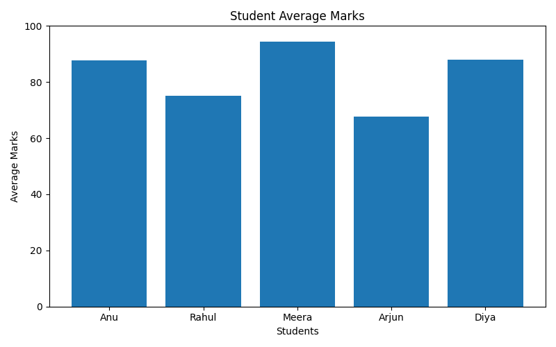

# Student Performance Analysis

## About the Project
A Python-based data analysis project that evaluates student
performance across Python, Mathematics, and Data Science.

## Features
- Calculates student averages and percentages
- Identifies the top-performing student
- Calculates subject-wise average marks
- Generates student performance charts
- Visualizes subject-wise average marks

## Technologies Used
- Python
- Matplotlib

## Requirements
- Python 3.x
- Matplotlib

## Installation

Install Matplotlib using:

```bash
python -m pip install matplotlib
```

## How to Run

1. Download or clone this repository.
2. Open the project folder in VS Code.
3. Run the following command:

```bash
python main.py
```

## Sample Dataset
The project uses sample student marks for demonstration.

## Future Improvements
- Read student data from a CSV file
- Add pass/fail analysis
- Generate a detailed performance report
- Create an interactive dashboard

## Author
AI & Data Science Student


## Visualizations

### Student Average Marks


### Subject-wise Average Marks


